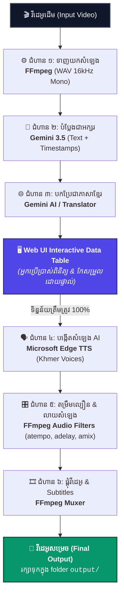

# 🎙️ Dubber Project - Architecture & Pipeline Flow

ឯកសារពិពណ៌នាលម្អិតអំពី **លំហូរការងារ (Pipeline Flow)** នៃប្រព័ន្ធបញ្ចូលសំឡេងស្វ័យប្រវត្តិ **AI Audio & Video Dubbing** ដោយប្រើប្រាស់ **Pure Node.js + FFmpeg**។

---

## 📊 ដ្យាក្រាមលំហូរការងារទាំងមូល (Architecture Flowchart)



```text
[ វីដេអូដើម (Input Video) ]
            │
            ▼
[ ជំហាន ១: ទាញយកសំឡេង (Audio Extraction) ]
            │  └──► បច្ចេកវិទ្យា: FFmpeg (WAV 16kHz Mono)
            ▼
[ ជំហាន ២: បំប្លែងសំឡេងជាអក្សរ (Transcription) ]
            │  └──► បច្ចេកវិទ្យា: Gemini 3.5 (Speech-to-Text + Timestamps)
            ▼
[ ជំហាន ៣: បកប្រែភាសា (Translation) ]
            │  └──► បច្ចេកវិទ្យា: Gemini AI / Deep Translator (ទៅជាភាសាខ្មែរ)
            ▼
┌─────────────────────────────────────────────────────────────┐
│ ★ ការត្រួតពិនិត្យ និងកែសម្រួល (Review & Edit - Human-in-the-Loop)│
│    └──► បច្ចេកវិទ្យា: Interactive Data Table លើ Web UI      │
│         (កែពាក្យខុស, សារ៉េ Timestamps, ស្ដាប់ Audio តេស្ត)       │
└─────────────────────────────────────────────────────────────┘
            │
            ▼
[ ជំហាន ៤: បង្កើតសំឡេង AI (Voice Synthesis) ]
            │  └──► បច្ចេកវិទ្យា: Microsoft Edge TTS (Piseth / Sreymom Neural)
            ▼
[ ជំហាន ៥: តម្រឹមល្បឿន និងលាយសំឡេង (Speed Align & Audio Mixing) ]
            │  └──► បច្ចេកវិទ្យា: FFmpeg Audio Filters (atempo, adelay, amix)
            ▼
[ ជំហាន ៦: ផ្គុំវីដេអូ និង Subtitles (Final Video Assembly) ]
            │  └──► បច្ចេកវិទ្យា: FFmpeg (Mux Audio + Burn-in Subtitles)
            ▼
[ វីដេអូសម្រេច (Final Dubbed & Subtitled Video) ]
            │
            └──► រក្សាទុកក្នុង: ថត `output/` & បង្ហាញលើ Video Player
```

---

## 🛠️ ការវិភាគលម្អិតតាមជំហាននីមួយៗ (Step-by-Step Breakdown)

### ជំហាន ១៖ ទាញយកសំឡេង (Audio Extraction)
- **បច្ចេកវិទ្យា:** `FFmpeg`
- **គោលបំណង:** ទាញយកតែ Track សំឡេងចេញពីវីដេអូដើម។
- **ទិន្នន័យចូល (Input):** ឯកសារវីដេអូ (`.mp4`, `.mkv`, `.mov` ...)
- **ទិន្នន័យចេញ (Output):** `audio_extracted.wav` (16kHz Mono)
- **FFmpeg Command គំរូ:**
  ```bash
  ffmpeg -i input_video.mp4 -vn -acodec pcm_s16le -ar 16000 -ac 1 audio_extracted.wav
  ```

---

### ជំហាន ២៖ បំប្លែងសំឡេងជាអក្សរ (Transcription & Timestamps)
- **បច្ចេកវិទ្យា:** `Google Gemini 3.5 API`
- **គោលបំណង:** ស្តាប់សំឡេង និងបង្កើតជាឃ្លាអត្ថបទព្រមទាំងម៉ោងកំណត់ (Start Time, End Time)។
- **ទិន្នន័យចេញ (Output JSON Example):**
  ```json
  [
    {
      "id": 1,
      "start": 0.5,
      "end": 3.2,
      "text": "Hello and welcome back to our channel."
    },
    {
      "id": 2,
      "start": 3.5,
      "end": 6.8,
      "text": "Today we will talk about artificial intelligence."
    }
  ]
  ```

---

### ជំហាន ៣៖ បកប្រែជាភាសាខ្មែរ (Translation with Context)
- **បច្ចេកវិទ្យា:** `Gemini AI` (ឬ `Deep Translator`)
- **គោលបំណង:** បកប្រែអត្ថបទឱ្យក្លាយជាភាសានិយាយសន្ទនាបែបបញ្ចូលសំឡេងរឿង ដោយរក្សាប្រវែងពាក្យឱ្យសមល្មមនឹងពេលវេលានិយាយដើម។
- **ទិន្នន័យចេញ (Output JSON Example):**
  ```json
  [
    {
      "id": 1,
      "start": 0.5,
      "end": 3.2,
      "original_text": "Hello and welcome back to our channel.",
      "translated_text": "សួស្តីបងប្អូនទាំងអស់គ្នា សូមស្វាគមន៍មកកាន់ឆានែលយើងខ្ញុំឡើងវិញ។"
    }
  ]
  ```

---

### ★ ចំណុចគន្លឹះ៖ ការត្រួតពិនិត្យ និងកែសម្រួល (Review & Edit - Human-in-the-Loop)
- **បច្ចេកវិទ្យា:** `Web UI (HTML5 + Tailwind CSS + Vanilla JS)`
- **គោលបំណង:** 
  - បង្ហាញទិន្នន័យទាំងអស់លើ Interactive Data Table
  - អនុញ្ញាតឱ្យអ្នកប្រើប្រាស់កែសម្រួលអក្ខរាវិរុទ្ធខ្មែរ
  - សារ៉េកែប្រែម៉ោង Start / End time ឱ្យត្រូវនឹងកាយវិការមាត់ (Lip Sync)
  - ធានាភាពត្រឹមត្រូវ ១០០% មុននឹងបញ្ជូនទៅបង្កើតសំឡេង AI។

---

### ជំហាន ៤៖ បង្កើតសំឡេង AI (Voice Synthesis)
- **បច្ចេកវិទ្យា:** `Microsoft Edge TTS` (Free & High Quality Neural Voices)
- **សំឡេងដែលគាំទ្រ:**
  - `km-KH-PisethNeural` (សំឡេងបុរស)
  - `km-KH-SreymomNeural` (សំឡេងស្ត្រី)
- **ទិន្នន័យចេញ:** ឯកសារសំឡេង `.mp3` ដាច់ដោយឡែកសម្រាប់ឃ្លានីមួយៗ (`segment_001.mp3`, `segment_002.mp3`...)

---

### ជំហាន ៥៖ តម្រឹមល្បឿន និងលាយសំឡេង (Speed Align & Audio Mixing)
- **បច្ចេកវិទ្យា:** `FFmpeg Audio Filters` (`atempo`, `adelay`, `amix`)
- **គោលបំណង:** 
  - គណនាប្រវែងសំឡេង AI ប្រៀបធៀបនឹងប្រវែងវីដេអូដើម
  - ប្រសិនបើសំឡេងខ្មែរវែងជាង ត្រូវបង្កើនល្បឿន (`atempo=X.XX`) ដោយមិនឱ្យបាត់បង់ Pitch សំឡេង
  - ពន្យារពេល (`adelay`) ឱ្យសំឡេងនីមួយៗបន្លឺឡើងត្រូវនឹងវិនាទីដែលបានកំណត់
  - លាយ (Mix) សំឡេង AI ជាមួយភ្លេងកំដរដើម (Background Music)។
- **FFmpeg Filter Command គំរូ:**
  ```bash
  # បង្កើនល្បឿនសំឡេង ១.១៥x ដោយរក្សា pitch
  ffmpeg -i segment_001.mp3 -filter:a "atempo=1.15" segment_001_aligned.mp3
  ```

---

### ជំហាន ៦៖ ផ្គុំវីដេអូ និង Subtitles (Final Video Assembly)
- **បច្ចេកវិទ្យា:** `FFmpeg Muxer`
- **គោលបំណង:**
  - បញ្ចូលសំឡេងដែលបាន Mix រួចទៅក្នុងវីដេអូដើម
  - បង្កប់ Subtitles (Hardsub ឬ Soft Subtitle SRT/VTT)
  - Export ចេញជាវីដេអូសម្រេចគុណភាពខ្ពស់ (`.mp4`)។
- **FFmpeg Command គំរូ:**
  ```bash
  ffmpeg -i input_video.mp4 -i final_dubbed_audio.wav -c:v copy -map 0:v:0 -map 1:a:0 output/final_dubbed_video.mp4
  ```

---

## 🏆 ហេតុអ្វីជ្រើសរើស Pure Node.js + FFmpeg (ជំនួស Python Pydub)?

1. **ដំណើរការលើតែមួយ Runtime (Single Environment):** មិនបាច់ដំឡើង Python, Virtualenv, ឬ Pip dependencies នាំឱ្យស្មុគស្មាញដល់ Deployment។
2. **ល្បឿនលឿនជាង (Superior Speed):** FFmpeg សរសេរដោយ C/C++ ដែលមានល្បឿន Processing លឿនបំផុត។
3. **គុណភាពសំឡេងខ្ពស់:** `atempo` របស់ FFmpeg ដំណើរការ Time-stretching បានល្អឥតខ្ចោះ មិនធ្វើឱ្យសំឡេងស្រួច (No chipmunk effect)។
